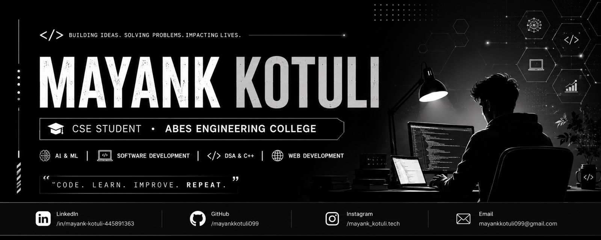

# 👋 MAYANK KOTULI

### 🎓 CSE • ABES ENGINEERING COLLEGE

**AI DEVELOPMENT • FULL-STACK • DSA IN C++ • CYBERSECURITY**

---

## 👨‍💻 ABOUT ME

Computer Science undergraduate at **ABES Engineering College** with hands-on experience building and deploying full-stack web applications.

I work mainly with **C++, Python and JavaScript**, with a strong interest in **AI development, full-stack engineering, Data Structures & Algorithms and cybersecurity**.

> **Build • Learn • Solve • Ship 🚀**

---

## ⚡ TECH STACK

<b>C++ & DSA</b> • <b>Full-Stack Development</b> • <b>AI Development</b> • <b>Cybersecurity</b>

---

## 📊 GITHUB ANALYTICS

## 🔥 CONTRIBUTION STREAK

> **Note:** These cards use live GitHub data. If a public stats service is temporarily rate-limited, the cards may take a little time to load again.

---

## 🚀 PROJECTS

### 🎓 ABES Autonomy
**Academic Resource Platform** • [abes.work](https://abes.work)

`React` `JavaScript` `MongoDB` `OAuth` `Vercel` `Render`

- Centralized platform for ABES students to access notes, PDFs and previous-year papers.
- Scaled the production platform to **800+ live users**.
- Integrated authentication, resource management and admin functionality.
- Maintained production deployment and shipped updates through Git & GitHub.

---

### 🤖 FormMitra AI
**AI-Powered Form Filling Platform** • AI for Bharat Hackathon 2026

`Next.js` `React` `Tailwind CSS` `FastAPI` `Python` `OCR` `LLM` `WebSockets` `ReportLab` `Docker`

- Built an AI platform that extracts form structure from uploaded PDFs/images using OCR.
- Added voice-based interaction to collect user information and automatically fill forms.
- Generates completed PDFs using ReportLab.
- Built a real-time Next.js + FastAPI architecture using WebSockets and Docker.

---

### 💻 InterVista
**Software Project**

- Designed and built InterVista as a software project.
- Source code and implementation details are available on GitHub.

---

## 🏆 ACHIEVEMENTS & EXPERIENCE

- **100+ CodeChef problems solved**
- Regular **DSA practice in C++**
- **Cybersecurity Training / Internship – DROP**  
  Approx. 2 months covering cybersecurity and network security fundamentals.
- **Smart India Hackathon (SIH)** – Internal Hackathon participant
- **Build with Bharat & Vibathon** – Participant
- **Core Member, Ignite Hub – ABES Engineering College**

---

## 🤝 CONNECT WITH ME

### ⚡ CODE • LEARN • BUILD • REPEAT

**Thanks for visiting my profile! ⭐**

